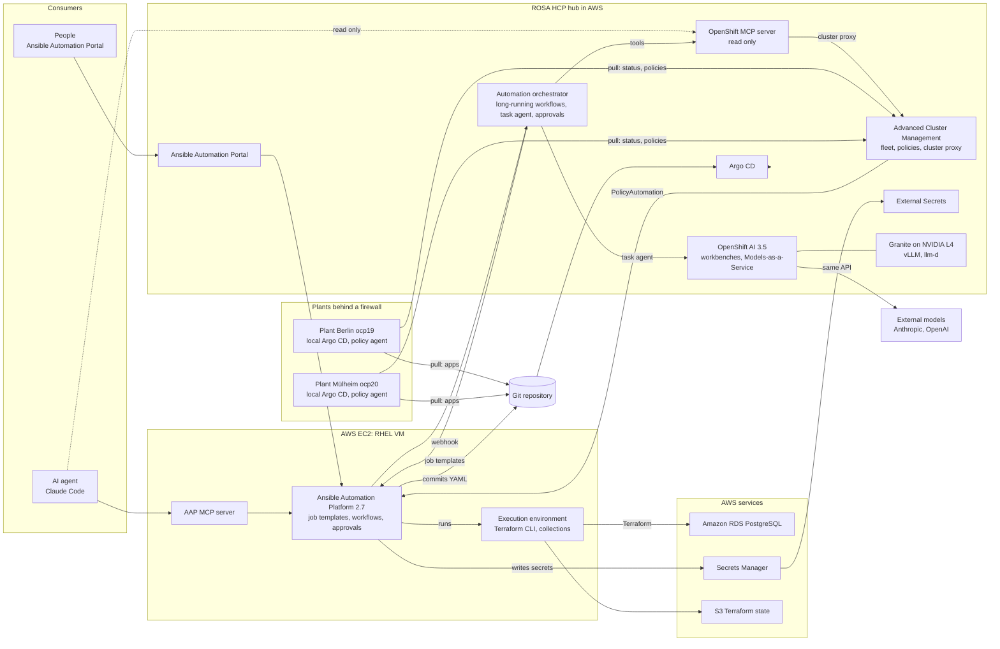

# Architecture

The final state of the demo platform (October 2026): one OpenShift hub in AWS, an automation
layer that serves people and AI agents the same way, and two plant clusters that pull their
desired state from Git. Everything is code in this repository; nothing in a cluster is changed
by hand.

## The picture



## Layers

| Layer | What runs there | Built by |
|---|---|---|
| AWS foundation | VPC (single AZ) with NAT, RHEL VM for AAP with Elastic IP and Let's Encrypt certificate, Route53 records, IAM (instance profile, IRSA for External Secrets), S3 for Terraform state | Terraform (`terraform/bootstrap`, `foundation`, `platform`) |
| Hub cluster | ROSA with hosted control planes, OpenShift 4.21, 4 × m6i.2xlarge workers, GPU pool with up to 2 × NVIDIA L4 | Terraform (`terraform/rosa`) |
| Hub platform | OpenShift GitOps, ACM with MultiClusterHub, External Secrets Operator, cert-manager, NFD and NVIDIA GPU Operator, Red Hat Connectivity Link, OpenShift AI 3.5 with Models-as-a-Service, Ansible Automation Portal, automation orchestrator, OpenShift MCP server | Argo CD, app of apps (`gitops/platform`, `gitops/components`) |
| Automation | AAP 2.7 containerized (growth topology) with MCP server, custom execution environment with the Terraform CLI | Ansible (`ansible/playbooks/aap-*.yml`), configuration as code over the REST API (`ansible/aap-config`) |
| Models | Granite 4.0 H-Tiny FP8 self-hosted (tier Local), Claude Haiku, Sonnet and Opus plus GPT-6 Luna as external models (tier Public), API keys and token limits per subscription | Argo CD (`gitops/components/ai-models`, `maas`) |
| Plants | Two OpenShift clusters imported into ACM, local Argo CD (installed by policy), the sample app Localnews | Manual ACM import (`scripts/edge-import.sh`), then policies and pull-model ApplicationSets |

## Main flows

**Self-service catalog.** People order in the portal, the agent through the AAP MCP server. Both
start the same job templates, with the same RBAC and the same audit trail. A job renders YAML,
commits it to `gitops/tenants/<cluster>/` and waits until Argo CD has synced it, on the hub or,
through the pull model, in a plant.

| Catalog item | Result |
|---|---|
| Catalog: Namespace | Namespace with quota and team access on the hub or in a plant |
| Catalog: AI Namespace | Data science project with a workbench (optionally with a GPU) and a Models-as-a-Service key |
| Catalog: Model Endpoint | API key, URL and model name for a self-hosted or external model |
| Catalog: Database | Workflow with approval; Terraform in the execution environment creates RDS PostgreSQL, the password goes to Secrets Manager, an ExternalSecret to Git |
| Catalog: Deploy App (Localnews) | The sample app, optionally with AI and an ordered database |

**Secrets.** No secret is ever in Git. Terraform and AAP write to AWS Secrets Manager
(`portfolio-demo/...`); Git holds only ExternalSecrets that point there. External Secrets reads
with IRSA, without static AWS keys in the cluster.

**Fleet.** One policy set in Git for every cluster (for example IEC 62443-3-3 SR 1.12, a system
use notification). ACM reports violations; a PolicyAutomation starts an AAP job that writes a
compliance report into `docs/compliance`. Switching a policy from `inform` to `enforce` is one
commit. Plant upgrades run as an AAP workflow with approval, pre-check, ACM ClusterCurator and
smoke test.

**Edge in the pull model.** The hub never connects into a plant. The klusterlet and the local
Argo CD connect outwards; policies and apps are pulled. The agent and the orchestrator read plant
state through the ACM cluster proxy with ManagedServiceAccounts that only have `view`.

**Models-as-a-Service.** Apps, agents and notebooks get a key, not a GPU. Self-hosted and
external models sit behind one OpenAI-compatible API, with subscriptions, token limits and usage
per team.

**Incident with the automation orchestrator.** A rule that is too strict breaks the plant app
in Berlin; ACM reports it, AAP hands it to the orchestrator. Ansible collects evidence, a task
agent on the self-hosted Granite looks into the plant through the read-only OpenShift MCP and
names the Git change that caused it, a person approves, Ansible reverts that commit, a loop waits
until the plant is healthy, and the incident report lands in Git. Details:
[automation-orchestrator.md](automation-orchestrator.md).

## Identities and permissions

| Identity | May do |
|---|---|
| `max` (AAP, orchestrator) | Order in the portal, approve databases, upgrades and incident fixes |
| `agent-claude` (AAP) | Start the catalog templates and "Operations: Report Incident" through MCP, read the results of internal steps; cannot approve |
| `acm-automation` (AAP) | Start compliance reports and incident reports for ACM |
| `orchestrator` (AAP) | Start only the four internal incident templates |
| ServiceAccount `aap` (hub) | Read Argo CD status, policies and managed clusters, create ClusterCurators, issue MaaS keys |
| `agent-viewer` (hub and plants) | `view`, used by the agent's and the orchestrator's MCP servers; no secrets |
| `orchestrator-diagnose` (hub) | May call the OpenShift MCP server (checked by an oauth-proxy with a SubjectAccessReview); only the diagnose step of the incident workflow gets its token |

Changes always go through an AAP template, and the expensive or risky ones through a human
approval. Agents investigate and report; people decide; Ansible makes the change.

## Repository layout

```
terraform/       bootstrap (state bucket), foundation (VPC, AAP VM, IAM), rosa, platform (IRSA, passwords), modules/dbaas
ansible/         execution environment, AAP install and configuration as code, catalog and operations playbooks,
                 orchestrator configuration and workflow (JSON)
gitops/          bootstrap (Argo CD and root app), platform (one Argo CD application per component),
                 components (manifests), tenants (written by AAP only)
apps/localnews/  Helm chart of the sample app
ai/samples/      notebooks for the workbenches
agent/           template for the demo agent's directory (CLAUDE.md, MCP configuration)
scripts/         helpers: retarget, terraform wrapper, hub login, GitOps bootstrap, edge import, incident injection
docs/            rebuild guide, orchestrator guide, build journal, manual steps, compliance and incident reports
```

## Technology Preview in this demo

Models-as-a-Service external models, the AAP MCP server and the OpenShift MCP server are
Technology Preview. The automation orchestrator is generally available (2026.8) as an add-on to
AAP 2.7; its install helper `aapctl` is Technology Preview and not used here.
